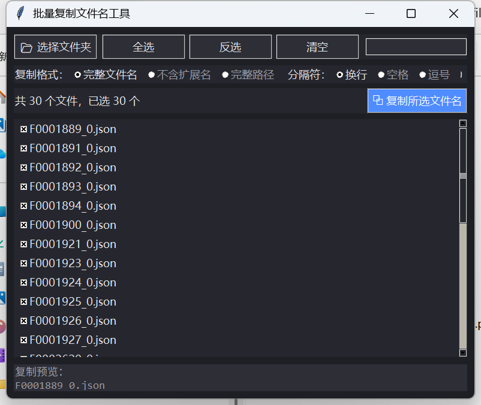

# 📋 FilenameCopier 批量复制文件名工具

> 勾选文件 → 一键复制文件名。小而专的 Windows 桌面小工具，单文件 exe、免安装、无联网。

[](https://github.com/zhangyc1224/FilenameCopier/actions/workflows/build.yml)




## ✨ 功能

- **勾选复制**：点击任意文件行切换勾选，支持「全选 / 反选 / 清空」，一键复制到剪贴板
- **搜索过滤**：输入关键字实时筛选，全选/反选只作用于可见文件
- **复制格式**：完整文件名 / 不含扩展名 / 完整路径
- **分隔符**：换行、空格、逗号、分号 —— 适配粘贴到 Excel、命令行、配置文件等不同场景
- **实时预览**：复制前先看到将要复制的内容
- **记住目录**：自动记住上次使用的文件夹，下次打开即用
- **单文件 exe**：约 11 MB，双击即用，不需要安装 Python，不写注册表

## 🚀 下载使用

前往 [Releases](../../releases) 下载 `FilenameCopier.exe`（或 `批量复制文件名.exe`），双击运行即可。

1. 点击「📂 选择文件夹」加载任意本地目录
2. 勾选需要的文件（可搜索过滤后全选）
3. 选好复制格式和分隔符
4. 点「⧉ 复制所选文件名」→ 去任意地方粘贴

## 🛠️ 本地构建

```bash
py -3.11 -m pip install pyinstaller
py -3.11 -m PyInstaller --onefile --windowed --name FilenameCopier filename_copier.py
# 产物在 dist/FilenameCopier.exe
```

推送到 GitHub 后，CI（`.github/workflows/build.yml`）会在打 `v*` 标签时自动打包并附到 Release。

## 🗺️ Roadmap

- [ ] 拖拽文件夹/文件到窗口加载
- [ ] 递归包含子目录（带相对路径）
- [ ] 导出为 JSON / CSV / Excel
- [ ] 文件大小、修改时间列显示
- [ ] 多语言（English UI）

## 📄 License

[MIT](LICENSE)

---

## English

**FilenameCopier** is a tiny Windows utility for batch-copying file names to the clipboard.

- Check files → copy names in one click (select all / invert / clear)
- Live keyword filter; selection actions apply to visible files only
- Output formats: full name / name without extension / full path
- Separators: newline, space, comma, semicolon
- Live preview, remembers last folder, single-file portable exe (~11 MB)

Download from [Releases](../../releases), or build locally:

```bash
pip install pyinstaller
pyinstaller --onefile --windowed --name FilenameCopier filename_copier.py
```

Licensed under the [MIT License](LICENSE).
